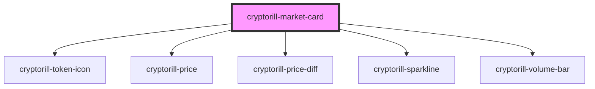

# cryptorill-market-card

<!-- Auto Generated Below -->

## Overview

Cryptorill Market Card Component
Comprehensive market data card displaying all key metrics for a cryptocurrency

Composite Structure:
- cryptorill-token-icon
- cryptorill-price
- cryptorill-price-diff
- cryptorill-sparkline
- cryptorill-volume-bar

## Properties

| Property      | Attribute     | Description                                                                                                                            | Type                              | Default  |
| ------------- | ------------- | -------------------------------------------------------------------------------------------------------------------------------------- | --------------------------------- | -------- |
| `change24h`   | `change-2-4h` | 24h percentage change (overridden by cryptoPrice.dayChange if cryptoPrice is provided)                                                 | `number`                          | `0`      |
| `cryptoPrice` | --            | CryptoPrice object from datasource (alternative to individual props) If provided, price and change24h will be derived from this object | `CryptoPrice \| null`             | `null`   |
| `currency`    | `currency`    | Currency code for formatting (default: 'USD')                                                                                          | `string`                          | `'USD'`  |
| `high24h`     | `high-2-4h`   | 24h high price                                                                                                                         | `number`                          | `0`      |
| `low24h`      | `low-2-4h`    | 24h low price                                                                                                                          | `number`                          | `0`      |
| `marketCap`   | `market-cap`  | Market capitalization                                                                                                                  | `number`                          | `0`      |
| `name`        | `name`        | Full cryptocurrency name                                                                                                               | `string`                          | `''`     |
| `price`       | `price`       | Current price (numeric value)                                                                                                          | `number`                          | `0`      |
| `size`        | `size`        | Size variant: 'sm' \| 'md' \| 'lg'                                                                                                     | `"lg" \| "md" \| "sm"`            | `'md'`   |
| `symbol`      | `symbol`      | Trading pair symbol (e.g., "BTC", "ETH")                                                                                               | `string`                          | `''`     |
| `theme`       | `theme`       | Theme variant: 'dark' \| 'light' \| 'gradient'                                                                                         | `"dark" \| "gradient" \| "light"` | `'dark'` |
| `volume24h`   | `volume-2-4h` | 24h trading volume                                                                                                                     | `number`                          | `0`      |

## Dependencies

### Depends on

- [cryptorill-token-icon](../cryptorill-token-icon)
- [cryptorill-price](../cryptorill-price)
- [cryptorill-price-diff](../cryptorill-price-diff)
- [cryptorill-sparkline](../cryptorill-sparkline)
- [cryptorill-volume-bar](../cryptorill-volume-bar)

### Graph

----------------------------------------------

*Built with [StencilJS](https://stenciljs.com/)*
