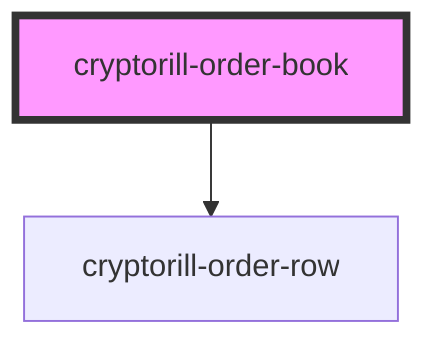

# cryptorill-order-book

<!-- Auto Generated Below -->

## Overview

Cryptorill Order Book Component
Two-column layout with asks (sell orders, red) on top, bids (buy orders, green) on bottom

Dependencies:
- cryptorill-order-row

## Properties

| Property       | Attribute       | Description                                     | Type                              | Default        |
| -------------- | --------------- | ----------------------------------------------- | --------------------------------- | -------------- |
| `asks`         | --              | Array of ask orders (sell orders)               | `Order[]`                         | `[]`           |
| `bids`         | --              | Array of bid orders (buy orders)                | `Order[]`                         | `[]`           |
| `bookTitle`    | `book-title`    | Title of the order book                         | `string`                          | `'Order Book'` |
| `cryptoSymbol` | `crypto-symbol` | Cryptocurrency symbol for amount formatting     | `string`                          | `'BTC'`        |
| `currency`     | `currency`      | Currency code for formatting                    | `string`                          | `'USD'`        |
| `grouping`     | `grouping`      | Price grouping increment (0 = no grouping)      | `number`                          | `0`            |
| `maxDepth`     | `max-depth`     | Maximum depth for calculating depth percentages | `number`                          | `0`            |
| `theme`        | `theme`         | Theme variant: 'dark' \| 'light' \| 'gradient'  | `"dark" \| "gradient" \| "light"` | `'dark'`       |

## Dependencies

### Depends on

- [cryptorill-order-row](../cryptorill-order-row)

### Graph

----------------------------------------------

*Built with [StencilJS](https://stenciljs.com/)*
