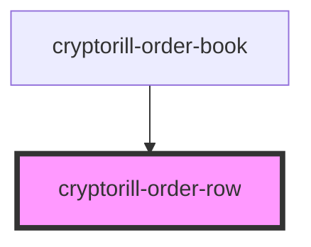

# cryptorill-order-row

<!-- Auto Generated Below -->

## Overview

Cryptorill Order Row Component
Single order book row with price, amount, total, and depth visualization bar

## Properties

| Property       | Attribute       | Description                                    | Type                              | Default  |
| -------------- | --------------- | ---------------------------------------------- | --------------------------------- | -------- |
| `amount`       | `amount`        | Order amount                                   | `number`                          | `0`      |
| `cryptoSymbol` | `crypto-symbol` | Cryptocurrency symbol for amount formatting    | `string`                          | `''`     |
| `currency`     | `currency`      | Currency code for formatting (default: 'USD')  | `string`                          | `'USD'`  |
| `depthPercent` | `depth-percent` | Depth percentage for visualization bar (0-100) | `number`                          | `0`      |
| `price`        | `price`         | Order price                                    | `number`                          | `0`      |
| `theme`        | `theme`         | Theme variant: 'dark' \| 'light' \| 'gradient' | `"dark" \| "gradient" \| "light"` | `'dark'` |
| `total`        | `total`         | Order total (price * amount)                   | `number`                          | `0`      |
| `type`         | `type`          | Order type: 'bid' (buy) or 'ask' (sell)        | `"ask" \| "bid"`                  | `'bid'`  |

## Dependencies

### Used by

 - [cryptorill-order-book](../cryptorill-order-book)

### Graph

----------------------------------------------

*Built with [StencilJS](https://stenciljs.com/)*
