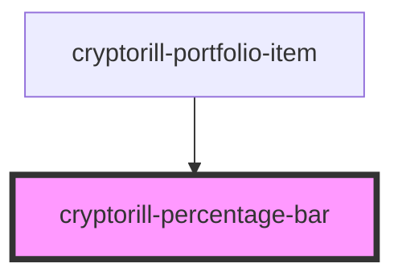

# cryptorill-percentage-bar

<!-- Auto Generated Below -->

## Overview

Cryptorill Percentage Bar Component
Horizontal bar showing percentage allocation/dominance

## Properties

| Property    | Attribute    | Description                                             | Type                              | Default     |
| ----------- | ------------ | ------------------------------------------------------- | --------------------------------- | ----------- |
| `color`     | `color`      | Optional custom color (hex, rgb, or css variable)       | `string \| undefined`             | `undefined` |
| `label`     | `label`      | Optional label to display                               | `string \| undefined`             | `undefined` |
| `maxValue`  | `max-value`  | Maximum value for percentage calculation (default: 100) | `number`                          | `100`       |
| `showValue` | `show-value` | Whether to show the percentage value                    | `boolean`                         | `true`      |
| `theme`     | `theme`      | Theme variant: 'dark' \| 'light' \| 'gradient'          | `"dark" \| "gradient" \| "light"` | `'dark'`    |
| `value`     | `value`      | Current value to display                                | `number`                          | `0`         |

## Dependencies

### Used by

 - [cryptorill-portfolio-item](../cryptorill-portfolio-item)

### Graph

----------------------------------------------

*Built with [StencilJS](https://stenciljs.com/)*
