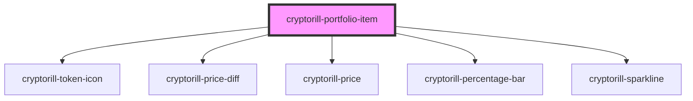

# cryptorill-portfolio-item

<!-- Auto Generated Below -->

## Overview

Cryptorill Portfolio Item Component
Displays a portfolio position with holdings, value, P&L and allocation

Composite Structure:
- cryptorill-token-icon
- cryptorill-price
- cryptorill-price-diff
- cryptorill-percentage-bar (allocation)
- cryptorill-sparkline

## Properties

| Property      | Attribute       | Description                                    | Type                              | Default     |
| ------------- | --------------- | ---------------------------------------------- | --------------------------------- | ----------- |
| `allocation`  | `allocation`    | Portfolio allocation percentage                | `number`                          | `0`         |
| `avgBuyPrice` | `avg-buy-price` | Average buy price                              | `number`                          | `0`         |
| `balance`     | `balance`       | Holdings amount                                | `number`                          | `0`         |
| `chartData`   | --              | Chart data points                              | `number[]`                        | `[]`        |
| `name`        | `name`          | Asset name (e.g., 'Bitcoin', 'Ethereum')       | `string`                          | `''`        |
| `pnl`         | `pnl`           | Profit/loss percentage                         | `number`                          | `0`         |
| `price`       | `price`         | Current price per unit                         | `number`                          | `0`         |
| `showChart`   | `show-chart`    | Show mini chart                                | `boolean`                         | `true`      |
| `size`        | `size`          | Size variant: 'compact' \| 'full'              | `"compact" \| "full"`             | `'full'`    |
| `symbol`      | `symbol`        | Asset symbol (e.g., 'BTC', 'ETH')              | `string`                          | `''`        |
| `theme`       | `theme`         | Theme variant: 'dark' \| 'light' \| 'gradient' | `"dark" \| "gradient" \| "light"` | `'dark'`    |
| `value`       | `value`         | Total value (calculated if not provided)       | `number \| undefined`             | `undefined` |

## Dependencies

### Depends on

- [cryptorill-token-icon](../cryptorill-token-icon)
- [cryptorill-price-diff](../cryptorill-price-diff)
- [cryptorill-price](../cryptorill-price)
- [cryptorill-percentage-bar](../cryptorill-percentage-bar)
- [cryptorill-sparkline](../cryptorill-sparkline)

### Graph

----------------------------------------------

*Built with [StencilJS](https://stenciljs.com/)*
