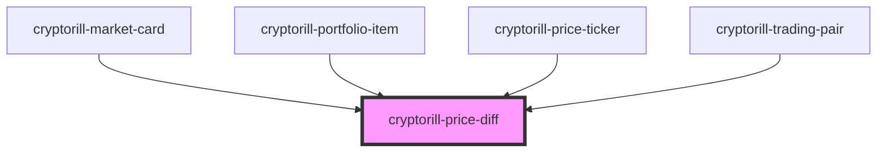

# cryptorill-price-diff

<!-- Auto Generated Below -->

## Overview

Cryptorill Price Diff Component
Displays price change percentage with visual indicators (arrow, color coding)

## Properties

| Property    | Attribute    | Description                                         | Type                              | Default    |
| ----------- | ------------ | --------------------------------------------------- | --------------------------------- | ---------- |
| `label`     | `label`      | Label to display after the percentage (e.g., "24h") | `string`                          | `'24h'`    |
| `showLabel` | `show-label` | Show the label                                      | `boolean`                         | `true`     |
| `size`      | `size`       | Size variant: 'small' \| 'medium' \| 'large'        | `"large" \| "medium" \| "small"`  | `'medium'` |
| `theme`     | `theme`      | Theme variant: 'dark' \| 'light' \| 'gradient'      | `"dark" \| "gradient" \| "light"` | `'dark'`   |
| `value`     | `value`      | The percentage value (positive or negative)         | `number`                          | `0`        |

## Dependencies

### Used by

 - [cryptorill-market-card](../cryptorill-market-card)
 - [cryptorill-portfolio-item](../cryptorill-portfolio-item)
 - [cryptorill-price-ticker](../cryptorill-price-ticker)
 - [cryptorill-trading-pair](../cryptorill-trading-pair)

### Graph

----------------------------------------------

*Built with [StencilJS](https://stenciljs.com/)*
