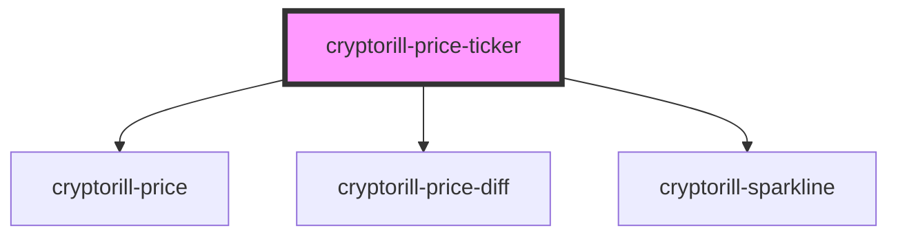

# cryptorill-price-ticker

<!-- Auto Generated Below -->

## Overview

Cryptorill Price Ticker Component
A modern, single-asset crypto price display with 2025/2026 design aesthetics
Features glassmorphism, dark mode, micro-interactions, and real-time indicators

This is a composite component that uses:
- <cryptorill-price> for price display
- <cryptorill-price-diff> for price change indicator
- <cryptorill-sparkline> for the trend chart

## Properties

| Property        | Attribute        | Description                                                                                                                     | Type                              | Default    |
| --------------- | ---------------- | ------------------------------------------------------------------------------------------------------------------------------- | --------------------------------- | ---------- |
| `interval`      | `interval`       | Refresh interval in milliseconds. Default is 30000 (30 seconds).                                                                | `number`                          | `30000`    |
| `name`          | `name`           | Full name of the cryptocurrency (e.g., "Bitcoin", "Ethereum") If not provided, will use metadata service or display symbol only | `string`                          | `''`       |
| `showSparkline` | `show-sparkline` | Show sparkline chart                                                                                                            | `boolean`                         | `true`     |
| `size`          | `size`           | Size variant: 'small' \| 'medium' \| 'large'                                                                                    | `"large" \| "medium" \| "small"`  | `'medium'` |
| `symbol`        | `symbol`         | Crypto symbol to display (e.g., "BTC", "ETH", "SOL")                                                                            | `string`                          | `'BTC'`    |
| `theme`         | `theme`          | Theme variant: 'dark' \| 'light' \| 'gradient'                                                                                  | `"dark" \| "gradient" \| "light"` | `'dark'`   |

## Dependencies

### Depends on

- [cryptorill-price](../cryptorill-price)
- [cryptorill-price-diff](../cryptorill-price-diff)
- [cryptorill-sparkline](../cryptorill-sparkline)

### Graph

----------------------------------------------

*Built with [StencilJS](https://stenciljs.com/)*
