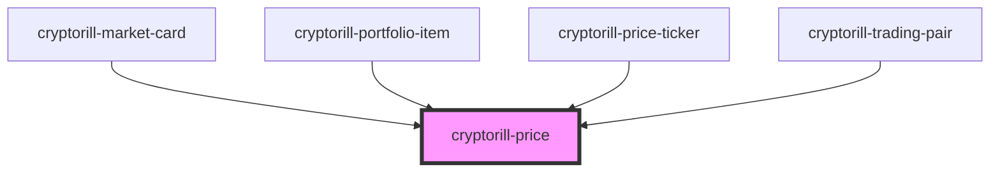

# cryptorill-price

<!-- Auto Generated Below -->

## Overview

Cryptorill Price Component
Displays a cryptocurrency price with currency symbol and flash animation on price changes

## Properties

| Property   | Attribute  | Description                                              | Type                              | Default    |
| ---------- | ---------- | -------------------------------------------------------- | --------------------------------- | ---------- |
| `currency` | `currency` | Currency symbol to display before the price (default: $) | `string`                          | `'$'`      |
| `size`     | `size`     | Size variant: 'small' \| 'medium' \| 'large'             | `"large" \| "medium" \| "small"`  | `'medium'` |
| `theme`    | `theme`    | Theme variant: 'dark' \| 'light' \| 'gradient'           | `"dark" \| "gradient" \| "light"` | `'dark'`   |
| `value`    | `value`    | The price value to display                               | `number \| string`                | `'0'`      |

## Dependencies

### Used by

 - [cryptorill-market-card](../cryptorill-market-card)
 - [cryptorill-portfolio-item](../cryptorill-portfolio-item)
 - [cryptorill-price-ticker](../cryptorill-price-ticker)
 - [cryptorill-trading-pair](../cryptorill-trading-pair)

### Graph

----------------------------------------------

*Built with [StencilJS](https://stenciljs.com/)*
