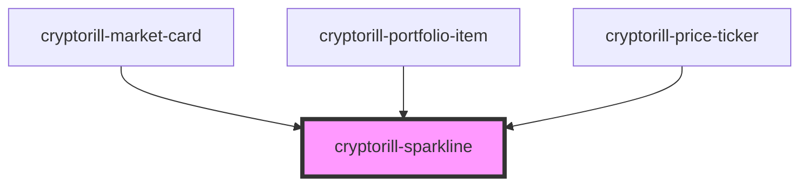

# cryptorill-sparkline

<!-- Auto Generated Below -->

## Overview

Cryptorill Sparkline Component
Renders a canvas-based sparkline chart with historical price data from /v1/price/historical endpoint

## Properties

| Property | Attribute | Description                                                                                                               | Type                              | Default     |
| -------- | --------- | ------------------------------------------------------------------------------------------------------------------------- | --------------------------------- | ----------- |
| `data`   | `data`    | Historical price data points as array of numbers (e.g., [100, 105, 102, 110]) If provided, datasource will not be queried | `number[] \| string \| undefined` | `undefined` |
| `height` | `height`  | Height of the canvas in pixels                                                                                            | `number`                          | `60`        |
| `limit`  | `limit`   | Number of data points to retrieve from historical endpoint (default: 25 for last 24h)                                     | `number`                          | `25`        |
| `pair`   | `pair`    | The cryptocurrency pair to query (e.g., "btcusdt")                                                                        | `string`                          | `'btcusdt'` |
| `points` | `points`  | Number of points to generate if data is not provided (fallback)                                                           | `number`                          | `20`        |
| `smooth` | `smooth`  | Enable smooth curves (quadratic bezier)                                                                                   | `boolean`                         | `true`      |
| `theme`  | `theme`   | Theme variant: 'dark' \| 'light' \| 'gradient'                                                                            | `"dark" \| "gradient" \| "light"` | `'dark'`    |
| `width`  | `width`   | Width of the canvas in pixels                                                                                             | `number`                          | `300`       |

## Dependencies

### Used by

 - [cryptorill-market-card](../cryptorill-market-card)
 - [cryptorill-portfolio-item](../cryptorill-portfolio-item)
 - [cryptorill-price-ticker](../cryptorill-price-ticker)

### Graph

----------------------------------------------

*Built with [StencilJS](https://stenciljs.com/)*
