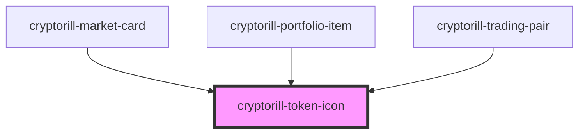

# cryptorill-token-icon

<!-- Auto Generated Below -->

## Overview

Cryptorill Token Icon Component
Displays a cryptocurrency icon with fallback to generated initials

## Properties

| Property   | Attribute  | Description                                                              | Type                              | Default     |
| ---------- | ---------- | ------------------------------------------------------------------------ | --------------------------------- | ----------- |
| `fallback` | `fallback` | Optional custom fallback text (defaults to first 2 characters of symbol) | `string \| undefined`             | `undefined` |
| `size`     | `size`     | Size variant: 'sm' \| 'md' \| 'lg'                                       | `"lg" \| "md" \| "sm"`            | `'md'`      |
| `src`      | `src`      | Optional source URL for the icon image                                   | `string \| undefined`             | `undefined` |
| `symbol`   | `symbol`   | Cryptocurrency symbol (e.g., 'BTC', 'ETH')                               | `string`                          | `''`        |
| `theme`    | `theme`    | Theme variant: 'dark' \| 'light' \| 'gradient'                           | `"dark" \| "gradient" \| "light"` | `'dark'`    |

## Dependencies

### Used by

 - [cryptorill-market-card](../cryptorill-market-card)
 - [cryptorill-portfolio-item](../cryptorill-portfolio-item)
 - [cryptorill-trading-pair](../cryptorill-trading-pair)

### Graph

----------------------------------------------

*Built with [StencilJS](https://stenciljs.com/)*
