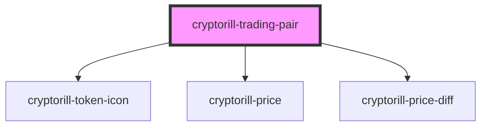

# cryptorill-trading-pair

<!-- Auto Generated Below -->

## Overview

Cryptorill Trading Pair Component
Displays trading pair with base/quote icons, price, change, and optional spread

Dependencies:
- cryptorill-token-icon
- cryptorill-price
- cryptorill-price-diff

## Properties

| Property      | Attribute      | Description                                                                                                                                 | Type                              | Default  |
| ------------- | -------------- | ------------------------------------------------------------------------------------------------------------------------------------------- | --------------------------------- | -------- |
| `baseSymbol`  | `base-symbol`  | Base asset symbol (e.g., "BTC")                                                                                                             | `string`                          | `''`     |
| `change24h`   | `change-2-4h`  | 24h percentage change (overridden by cryptoPrice.dayChange if cryptoPrice is provided)                                                      | `number`                          | `0`      |
| `cryptoPrice` | --             | CryptoPrice object from datasource (alternative to price/change24h props) If provided, price and change24h will be derived from this object | `CryptoPrice \| null`             | `null`   |
| `price`       | `price`        | Current price (numeric value)                                                                                                               | `number`                          | `0`      |
| `quoteSymbol` | `quote-symbol` | Quote asset symbol (e.g., "USDT")                                                                                                           | `string`                          | `''`     |
| `showSpread`  | `show-spread`  | Show spread indicator                                                                                                                       | `boolean`                         | `true`   |
| `size`        | `size`         | Size variant: 'sm' \| 'md' \| 'lg'                                                                                                          | `"lg" \| "md" \| "sm"`            | `'md'`   |
| `spread`      | `spread`       | Bid-ask spread percentage                                                                                                                   | `number`                          | `0`      |
| `theme`       | `theme`        | Theme variant: 'dark' \| 'light' \| 'gradient'                                                                                              | `"dark" \| "gradient" \| "light"` | `'dark'` |

## Dependencies

### Depends on

- [cryptorill-token-icon](../cryptorill-token-icon)
- [cryptorill-price](../cryptorill-price)
- [cryptorill-price-diff](../cryptorill-price-diff)

### Graph

----------------------------------------------

*Built with [StencilJS](https://stenciljs.com/)*
