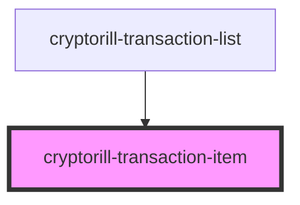

# cryptorill-transaction-item

<!-- Auto Generated Below -->

## Properties

| Property       | Attribute      | Description                                                | Type                                       | Default      |
| -------------- | -------------- | ---------------------------------------------------------- | ------------------------------------------ | ------------ |
| `amount`       | `amount`       | Transaction amount                                         | `number`                                   | `0`          |
| `counterparty` | `counterparty` | Counterparty address (to/from)                             | `string`                                   | `''`         |
| `fee`          | `fee`          | Optional transaction fee                                   | `number \| undefined`                      | `undefined`  |
| `status`       | `status`       | Transaction status: 'pending' \| 'confirmed' \| 'failed'   | `"confirmed" \| "failed" \| "pending"`     | `'pending'`  |
| `symbol`       | `symbol`       | Asset symbol (e.g., 'BTC', 'ETH')                          | `string`                                   | `''`         |
| `theme`        | `theme`        | Theme variant: 'dark' \| 'light' \| 'gradient'             | `"dark" \| "gradient" \| "light"`          | `'dark'`     |
| `timestamp`    | `timestamp`    | Transaction timestamp (Date object or ISO string)          | `Date \| string`                           | `new Date()` |
| `type`         | `type`         | Transaction type: 'send' \| 'receive' \| 'swap' \| 'stake' | `"receive" \| "send" \| "stake" \| "swap"` | `'send'`     |

## Dependencies

### Used by

 - [cryptorill-transaction-list](../cryptorill-transaction-list)

### Graph

----------------------------------------------

*Built with [StencilJS](https://stenciljs.com/)*
