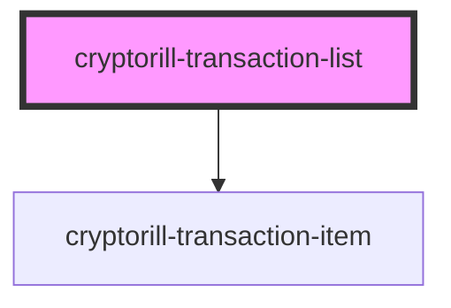

# cryptorill-transaction-list

<!-- Auto Generated Below -->

## Overview

Cryptorill Transaction List Component
Displays a list of transactions with optional filtering and status indicators

## Properties

| Property       | Attribute       | Description                                                            | Type                              | Default                   |
| -------------- | --------------- | ---------------------------------------------------------------------- | --------------------------------- | ------------------------- |
| `emptyMessage` | `empty-message` | Empty state message                                                    | `string`                          | `'No transactions found'` |
| `listTitle`    | `list-title`    | Title for the list                                                     | `string`                          | `'Recent Transactions'`   |
| `maxItems`     | `max-items`     | Maximum number of items to display                                     | `number`                          | `10`                      |
| `showIcon`     | `show-icon`     | Show transaction type icon                                             | `boolean`                         | `true`                    |
| `theme`        | `theme`         | Theme variant: 'dark' \| 'light' \| 'gradient'                         | `"dark" \| "gradient" \| "light"` | `'dark'`                  |
| `transactions` | `transactions`  | Array of transactions to display (can be Transaction[] or JSON string) | `Transaction[] \| string`         | `[]`                      |

## Dependencies

### Depends on

- [cryptorill-transaction-item](../cryptorill-transaction-item)

### Graph

----------------------------------------------

*Built with [StencilJS](https://stenciljs.com/)*
