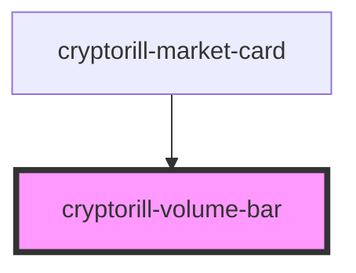

# cryptorill-volume-bar

<!-- Auto Generated Below -->

## Overview

Cryptorill Volume Bar Component
Visual volume indicator with bar representation

## Properties

| Property    | Attribute    | Description                                    | Type                              | Default     |
| ----------- | ------------ | ---------------------------------------------- | --------------------------------- | ----------- |
| `currency`  | `currency`   | Currency code for formatting (default: 'USD')  | `string`                          | `'USD'`     |
| `label`     | `label`      | Optional label to display                      | `string \| undefined`             | `undefined` |
| `maxVolume` | `max-volume` | Maximum volume for percentage calculation      | `number`                          | `0`         |
| `theme`     | `theme`      | Theme variant: 'dark' \| 'light' \| 'gradient' | `"dark" \| "gradient" \| "light"` | `'dark'`    |
| `volume`    | `volume`     | Volume value to display                        | `number`                          | `0`         |

## Dependencies

### Used by

 - [cryptorill-market-card](../cryptorill-market-card)

### Graph

----------------------------------------------

*Built with [StencilJS](https://stenciljs.com/)*
